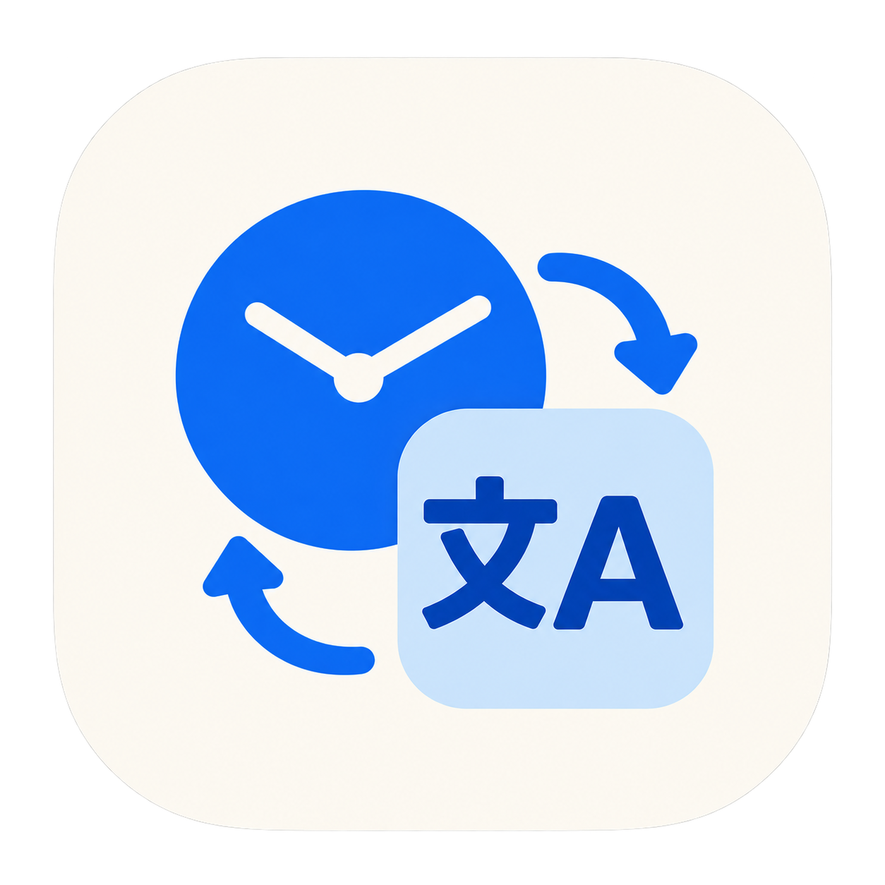

<p align="center">
  
</p>

# LocaleShift

**给 Mac 保存多套语言、地区和时区设置，切换后也能随时看北京时间，一键恢复原来的环境。**

LocaleShift 是一个原生 macOS 菜单栏工具。它起源于一个实际需求：在国内使用 AI 工具、进行跨地区工作或测试时，经常需要来回调整系统语言、地区和时区。设置分散在系统面板里，改完容易忘记原值，切到海外时区后又不方便查看本地时间。

LocaleShift 把这些操作收进菜单栏：先保存系统默认配置，再创建需要的地区配置；工作时查看两个时区的日期和时间，结束后恢复原来的完整设置。

**当前为开发预览版，源码按 MIT 开源。尚未提供完成正式签名、公证及广泛兼容性验证的通用安装包。**

## 能做什么

- **多套配置**：保存不同语言、地区和时区组合，切换前预览差异。
- **自动推荐**：选择国家或地区后推荐系统语言和首都／行政中心时区，支持手动调整。
- **中文地点搜索**：支持常用城市名，以及美国州名、州代码和部分城市别名。
- **双时钟**：同时显示系统默认时区和当前／目标时区的日期、时间、时差与跨日关系。
- **恢复系统默认**：恢复首次确认保存的完整语言顺序、地区和时区。
- **退出与异常恢复**：退出时先恢复并核验；独立后台服务处理部分进程中断后的恢复责任。
- **本地保存**：配置和操作记录保存在本机，应用没有云端同步或内置遥测上传。

例如，保存“简体中文 + 中国地区 + 上海时区”为系统默认，再创建“英语（美国）+ 美国地区 + 洛杉矶时区”。切换后，菜单栏仍可查看默认的北京时间，卡片同时显示洛杉矶时间。

这里的“系统默认”是你确认保存的恢复基准，不是出厂设置，也不会自动跟随所在地变化。

## 当前支持范围

| 项目 | 当前状态 |
| --- | --- |
| 平台 | macOS 原生应用，SwiftUI + AppKit |
| 界面 | 简体中文 |
| 编译最低目标 | macOS 13；不代表该版本已通过功能验收 |
| 系统修改能力 | 当前仅对 **macOS 27.0.1 / Apple Silicon（arm64）** 开放 |
| 其他 macOS 版本／Intel | 保持系统修改关闭；界面运行及构建兼容性仍需验证 |
| 普通 ad-hoc 构建 | 配置管理、预览、时钟和引导；系统修改关闭 |
| 本机测试模式 | 需要自行构建、管理员安装固定副本并批准后台服务 |
| 正式分发 | 签名、公证、升级和跨系统验收仍待完成 |

完整边界见 [验证与兼容性](docs/validation.md)。系统能力限制位于 `Sources/LocaleShiftSystem/Capabilities.swift`，请先提交对应实机证据，再讨论扩大支持范围。

## 从源码运行

需要 Mac、Python 3，以及可用的 Swift 工具链。可先安装 Apple Command Line Tools：

```sh
xcode-select --install
```

下载源码后，在项目目录执行：

```sh
python3 scripts/build_app.py
open build/LocaleShift.app
```

这是**只读开发包**，适合先体验界面和配置管理。构建不注册后台服务，不修改语言、地区或时区；源码没有第三方 Swift 包网络依赖。

需要实际切换系统设置，请阅读 [构建与本机测试安装](docs/building.md)。仅打开后台开关，不能让普通只读包获得系统修改能力。

## 使用流程

1. 首次打开时，确认并保存当前的完整语言顺序、地区和时区。如果当前已经是临时环境，先修正保存内容。
2. 按引导手动关闭“使用你的当前位置自动设定时区”，网络校时保持原样。
3. 添加一套设置，选择国家或地区，核对推荐语言和城市／时区。
4. 从菜单栏预览并应用。实际切换需要受支持的系统及已获准的后台恢复服务。
5. 结束后点击“恢复系统默认”；退出应用也会先尝试恢复并核验。

## 几个容易混淆的地方

**它修改的是时区，不是把系统时钟拨快或拨慢。** 系统绝对时间和网络校时保持原样。语言、地区作用于当前用户；系统时区作用于整台 Mac。

**它管理本机设置，不管理网络出口。** 不提供代理、VPN、IP 切换或网络位置检测；本机设置也不决定第三方服务的访问资格。

**系统语言写入后，应用界面可能需要退出并重新打开才更新。** 浏览器可能保留自己的语言偏好；终端的 `LANG`／`LC_*` 也不在当前管理范围内。

**自动时区由用户手动管理。** 应用不读取或切换这个开关；恢复系统默认时也不会自动重新开启它。

## 开发与贡献

```sh
./scripts/test.sh
python3 scripts/build_app.py --configuration release --output build/check/LocaleShift.app
```

测试使用隔离数据和模拟系统适配器，不进行真实系统设置切换。CI 检查编译、测试和打包，不代表真实系统功能验收。

欢迎提交问题、改进中文地点数据、贡献不同 macOS 版本的实机验证，以及完善签名和发布流程。开始前可看：

- [贡献指南](CONTRIBUTING.md)
- [工程结构与恢复机制](docs/architecture.md)
- [构建与本机测试安装](docs/building.md)
- [验证与兼容性](docs/validation.md)
- [第三方数据与资源说明](THIRD_PARTY_NOTICES.md)

## 许可证

[MIT](LICENSE) · Copyright © 2026 BlackCat-G
